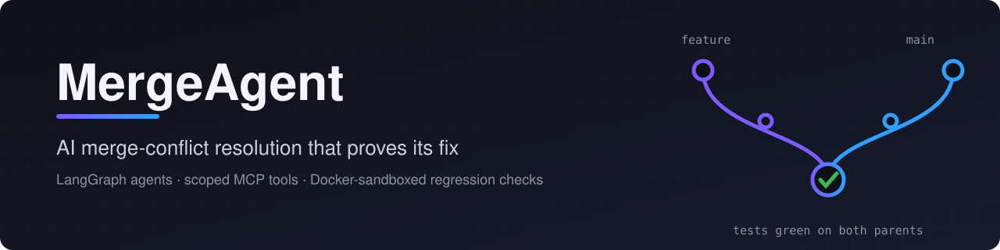
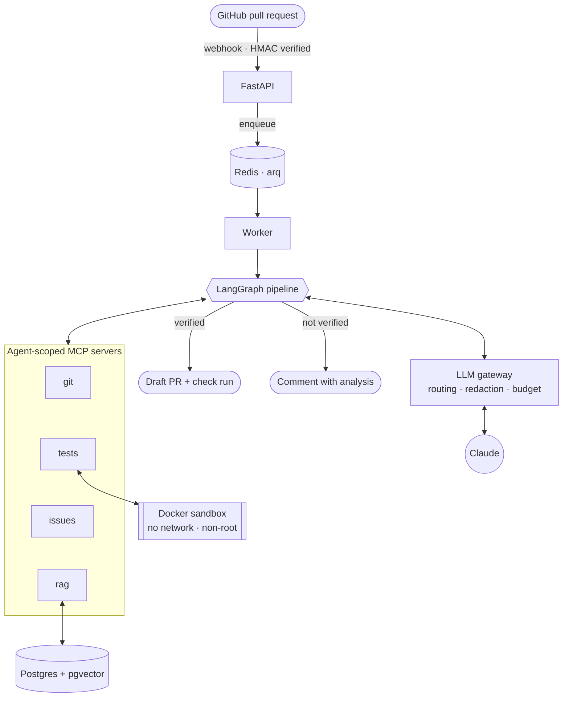
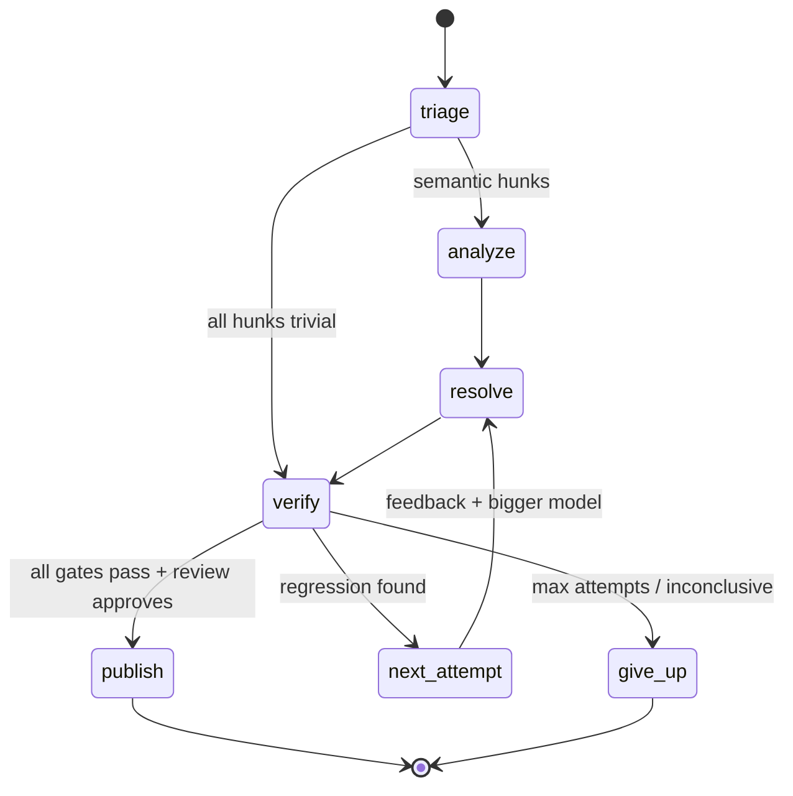
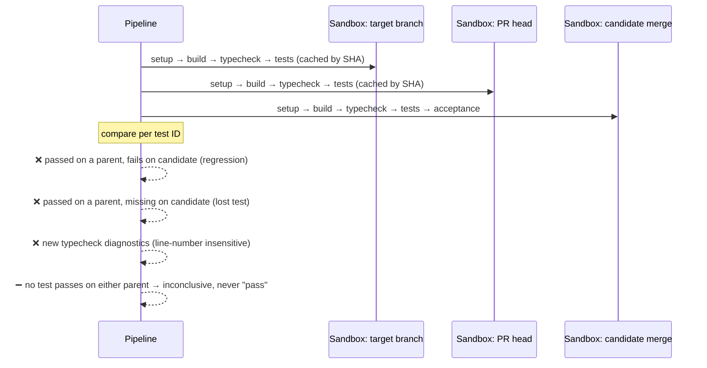

<p align="center">
  
</p>

<p align="center">
  <a href="https://github.com/vedant-1807/ai-merge-conflict-resolver/actions/workflows/ci.yml"></a>
  
  
  
  
  
  <a href="LICENSE"></a>
</p>

<p align="center">
  <a href="#-how-it-works">How it works</a> ·
  <a href="#-quick-start">Quick start</a> ·
  <a href="#-benchmark">Benchmark</a> ·
  <a href="#-design-decisions">Design decisions</a> ·
  <a href="docs/security.md">Security</a>
</p>

---

**MergeAgent** is a GitHub App that resolves pull-request merge conflicts with a team of LLM agents. It only opens a draft PR when the fix is **proven**: both parent branches and the candidate merge run the project's own test suite in isolated Docker sandboxes, and any regression blocks the PR.

> **Why?** Resolving conflicts is easy to automate badly. A merge that compiles can still silently drop a feature from one side. MergeAgent treats "the tests that passed on either branch still pass" as the bar, not "the conflict markers are gone".

## ✨ Highlights

| Capability | What it does |
|---|---|
| 🧠 **Multi-agent pipeline** | LangGraph state machine: deterministic **triage** → **analyzer** (intent of each side) → **resolver** → **verifier**, with retry-and-escalate on failure |
| 🔐 **Least-privilege MCP tools** | Four MCP servers (git, tests, issues, RAG). Each agent gets an allowlist: the analyzer can't write, and the verifier can't edit what it judges |
| 💸 **LLM gateway** | Cost-aware routing (Haiku → Sonnet → Opus), secret redaction, per-job USD budgets enforced atomically in Redis, prompt caching, per-call accounting |
| 🧪 **Regression verification** | Target branch vs PR head vs candidate merge: build, typecheck, tests and acceptance checks; flags tests that regress *or disappear* |
| 📦 **Hardened sandbox** | Fresh container per snapshot, no bind mounts, non-root, zero capabilities, no network during tests, cgroup limits, gVisor-ready |
| 🔎 **Code RAG** | pgvector HNSW + Postgres full-text search, fused with reciprocal-rank fusion; incremental, function-level indexing |

## 🔄 How it works



### The agent graph



| Node | Role | Model |
|---|---|---|
| `triage` | Resolves identical, one-sided, whitespace, import-block, changelog-append and lockfile hunks with **no LLM call**; scores the rest for complexity | none |
| `analyze` | Recovers *why* each side changed: diffs, `git log -L`, PR text, linked issues, callers found through RAG | routed by complexity |
| `resolve` | Writes each hunk through `git__write_resolution`, which rejects leftover markers or unparseable files immediately | routed, **escalates on retry** |
| `verify` | Runs the sandbox regression pipeline, then an independent reviewer agent checks the diff against both intents | routed |
| `publish` | Merge commit → branch → **draft PR** into the PR's branch + check run (fork PRs get the patch as a comment) | none |

### What "verified" means



## 🚀 Quick start

```bash
git clone https://github.com/vedant-1807/ai-merge-conflict-resolver && cd ai-merge-conflict-resolver
uv sync
uv run mergeagent demo        # offline: real graph, MCP tools and tests; no API key needed
```

<details>
<summary><b>Example output</b></summary>

```text
  • triage: 4 hunks, 1 resolved deterministically, 3 need reasoning
  • analyzer: 2 steps, tools=2
  • resolver[calc.py] attempt 1: 2 steps via ['fake-small']
  • resolver[legacy.py] attempt 1: 2 steps via ['fake-medium']
  • resolver[test_calc.py] attempt 1: 2 steps via ['fake-small']
  • verify attempt 1: pass (all gates passed: no regressions against either parent)
  • review: approve=True
  • publish: verified resolution written to mergeagent-out/local-2af65854.patch

status: resolved
LLM calls: 10  cost: $0.0059  models: ['fake-medium', 'fake-small']
```

The demo uses a scripted stand-in for Claude. Everything else is real: git merge, MCP tool calls, budget accounting, and the regression tests.
</details>

**Resolve two real branches with Claude:**

```bash
export LLM__ANTHROPIC_API_KEY=sk-ant-...
uv run mergeagent resolve --repo ../your-repo --ours feature --theirs main
```

**Run the full GitHub App stack** (API + worker + Postgres/pgvector + Redis):

```bash
cp .env.example .env          # GitHub App id/key/secret + Anthropic key
make sandbox-images
docker compose up -d --build  # migrations run automatically
curl localhost:8000/readyz    # {"status":"ok","checks":{"postgres":"ok","redis":"ok"}}
```

Then register the App from [`app.yml`](app.yml) by following [docs/github-app-setup.md](docs/github-app-setup.md). Open a conflicting PR, or comment **`/resolve`** on one.

## 📊 Benchmark

The evaluation harness re-merges the parents of **real historical merge commits** and runs the production pipeline on them. Full method: [docs/evaluation.md](docs/evaluation.md).

**Dataset:** 100 merges that genuinely conflict when re-merged, 20 each from five pytest-based projects, with **231 conflict hunks** in total.

| Repository | Merges | Test suite run per snapshot |
|---|---:|---:|
| [pallets/flask](https://github.com/pallets/flask) | 20 | ~490 tests |
| [pallets/click](https://github.com/pallets/click) | 20 | ~2,080 tests |
| [pallets/werkzeug](https://github.com/pallets/werkzeug) | 20 | ~1,040 tests |
| [pallets/jinja](https://github.com/pallets/jinja) | 20 | ~910 tests |
| [pytest-dev/pytest](https://github.com/pytest-dev/pytest) | 20 | ~3,780 tests |

| Metric | Result | Command |
|---|---|---|
| Hunks resolved by deterministic triage (zero LLM calls) | **28.1%** (65 / 231) · 16 merges need no LLM at all | `make eval-mine` |
| Injected behavioral regressions caught before a PR | ⏳ running | `make eval-mutate` |
| Test-verified resolution rate | ⏳ running | `make eval-run` |
| LLM cost per attempt, routed vs all-Opus | ⏳ running | `make eval-cost` |

<sub>Results are generated by `make eval-report` into <a href="docs/evaluation-results.md">docs/evaluation-results.md</a>. Only measured numbers appear here.</sub>

## 🧩 Design decisions

<details>
<summary><b>Why a deterministic triage step before any LLM?</b></summary>

About a quarter of real conflict hunks are mechanical: both sides made the same edit, only one side changed, import blocks diverged, both appended to a changelog, or a lockfile changed. Resolving these with rules costs nothing, is exact, and leaves the model budget for the semantic hunks.
</details>

<details>
<summary><b>Why agent-scoped MCP servers instead of passing every tool to every agent?</b></summary>

The repository is untrusted input and may contain prompt injection. Least privilege limits what a hijacked agent can do: the analyzer has read-only git, the resolver can only write inside conflict regions, and only the verifier can run the sandbox. The servers are standard MCP (`mcp` SDK), connected in-process per job, and can be served over stdio or HTTP without code changes.
</details>

<details>
<summary><b>How does routing save money without losing quality?</b></summary>

The router picks the cheapest tier likely to succeed from task type, hunk complexity, attempt number and remaining budget. A failed verification escalates the retry to a bigger model. The benchmark runs the same scenarios routed and with a fixed model, and reports cost per attempt *next to* the verified rate.
</details>

<details>
<summary><b>How is the budget enforced with several agents in flight?</b></summary>

Before every call the gateway **reserves** the worst-case cost (prompt size + max output) in a Redis Lua script. Afterwards it **settles** against the actual usage. Reservation is atomic, so concurrent calls can't overspend. Exhaustion becomes a clean `needs_human` outcome, not a crash.
</details>

<details>
<summary><b>Why can't a PR weaken its own verification?</b></summary>

Build and test commands come from `.mergeagent.yml` on the **target** branch, never from the PR under test.
</details>

## 🛠️ Tech stack

| Layer | Choice |
|---|---|
| Orchestration | LangGraph |
| Agent tools | Model Context Protocol (`mcp` SDK) |
| Models | Claude Haiku / Sonnet / Opus via the Anthropic SDK |
| API | FastAPI, Pydantic v2 |
| Queue | Redis + arq |
| Data | PostgreSQL 16, pgvector (HNSW), SQLAlchemy 2 async, Alembic |
| Sandbox | Docker SDK, optional gVisor |
| Quality | uv, ruff, mypy `--strict`, pytest (unit + integration on real Postgres/Redis/Docker) |
| Delivery | Multi-stage non-root image, Compose, GitHub Actions, GHCR |

<details>
<summary><b>Project layout</b></summary>

```text
src/mergeagent/
├── agents/        LangGraph state, nodes, tool loop, prompts
├── conflicts/     diff3 parser, triage, applier, validators
├── workspace/     hardened git wrapper, input sanitising
├── mcp_servers/   git / tests / issues / rag servers + scoped registry
├── llm/           gateway, router, redaction, budget, pricing, providers
├── rag/           chunker, embeddings, pgvector + in-memory stores
├── sandbox/       Docker (hardened) and local backends
├── verification/  repo config, report parsers, comparator, pipeline
├── github/        App auth, REST client, publisher
├── api/  queue/   FastAPI app, arq worker tasks
└── eval/          mining, benchmark, mutation study, report
```
</details>

## 🧪 Development

```bash
make lint typecheck test   # ruff · mypy --strict · unit tests
make test-integration      # real Postgres/pgvector, Redis and Docker sandbox
```

CI runs all of the above plus the offline demo and an image build on every push. Tagging `v*` publishes multi-arch images to GHCR.

## 📄 License

[MIT](LICENSE) © Vedant Bhenia
